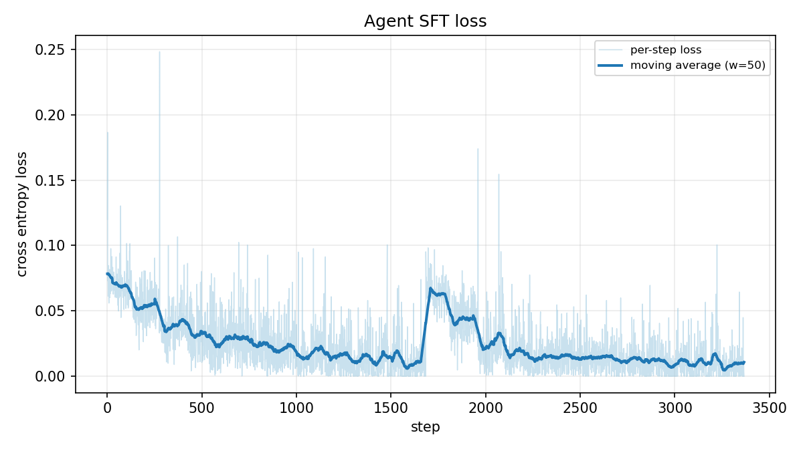
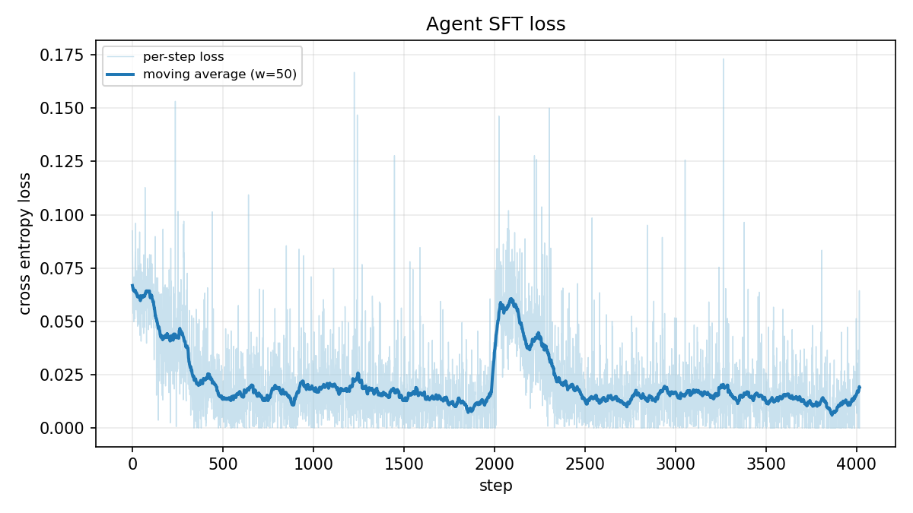
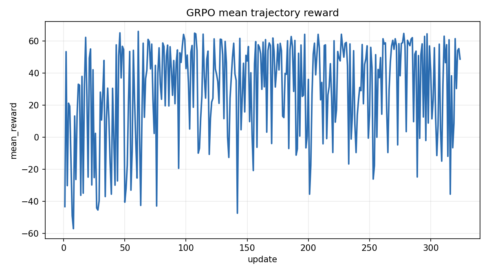
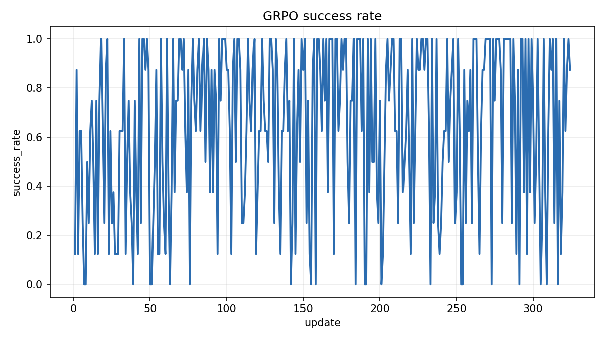
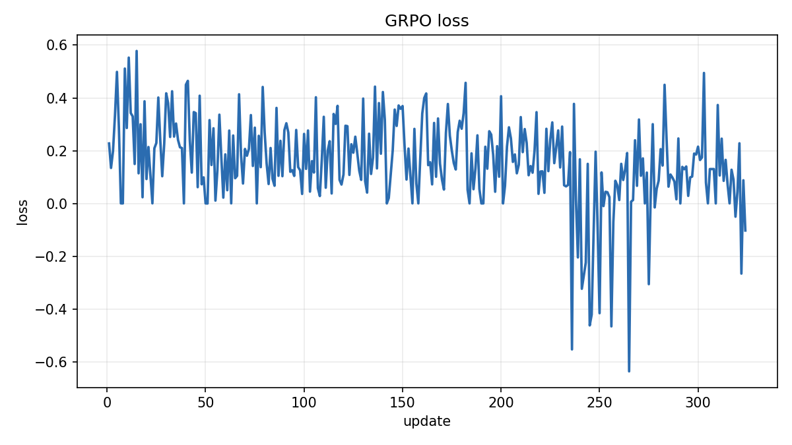
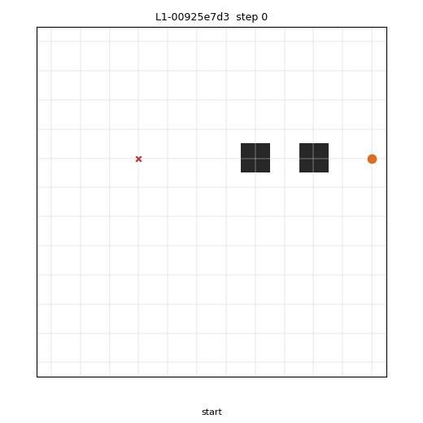
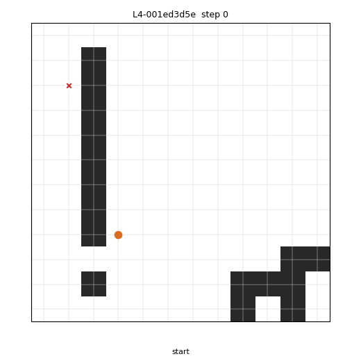
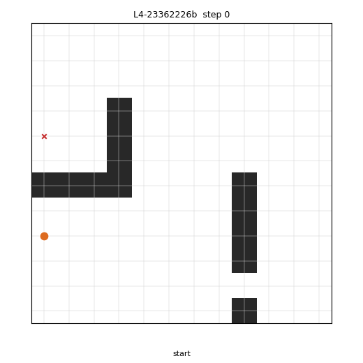

# HowToMove

一个基于 Qwen3 的 **标准 tool-calling Agent**：模型读取静态迷宫地图，通过
`move` 工具一步步移动，从 start 走到 goal。

当前仓库聚焦三件事：

```text
map-only 数据集生成
Agent SFT 冷启动
Agent GRPO 强化学习
```

---

## 1. 目标

最终目标是处理：

- 任意 12×12 地图；
- 任意墙体布局；
- 任意 start / goal；
- 多步轨迹；
- 撞墙反馈与恢复；
- 统一 SFT + GRPO 训练。

当前版本使用固定 12×12、`max_steps=30`。

Agent 协议：

```text
system: 静态地图
user:   Begin the maze.

assistant: <tool_call>move(direction)</tool_call>
tool:      compact JSON result

assistant: ...
...
```

---

## 2. 数据集制作

### 2.1 数据单位

当前只保存 **Map**，不保存轨迹：

```text
Map = 尺寸 + 具体墙体坐标 + start + goal
```

```json
{
  "id": "L1-0123456789",
  "level": "L1",
  "width": 12,
  "height": 12,
  "max_steps": 30,
  "walls": [[0,4], [1,4], [2,4]],
  "start": [4,7],
  "goal": [2,2],
  "shortest": 9,
  "detour": 2,
  "hash": "..."
}
```

Map 唯一性由以下内容哈希决定：

```text
width + height + sorted absolute walls + start + goal
```

同一墙形放在不同位置，或 start/goal 不同，都视为不同 map。

### 2.2 数据规模

```text
data/maps/train.jsonl   4000
data/maps/val.jsonl      500
data/maps/test.jsonl     500
```

每个 level：

| level | train | val | test |
|---|---:|---:|---:|
| L0 | 800 | 100 | 100 |
| L1 | 800 | 100 | 100 |
| L2 | 800 | 100 | 100 |
| L3 | 800 | 100 | 100 |
| L4 | 800 | 100 | 100 |

### 2.3 Split

- L1–L4：按**具体墙体集合** `wall_set` 隔离；
- L0：只有一个空墙集合，按 map/start-goal 划分。

同一个 `wall_set` 不会跨 train/val/test（L0 除外）。

### 2.4 生成与检查

```bash
python scripts/build_maps_v3.py \
  --out data \
  --seed 7 \
  --per-level 1000 \
  --train 800 --val 100 --test 100

python scripts/check_maps_v3.py --data data
```

更多说明见：

```text
reports/DATASET.md
```

---

## 3. Agent 设置

### 3.1 模型

```text
Qwen3-0.6B
LoRA: r=16, alpha=32
```

LoRA 权重可按任务加载；基础模型保持冻结。
> 0.6B的模型 对于这类任务会不会太小了。
### 3.2 工具

只有一个工具：

```python
{
    "name": "move",
    "arguments": {
        "direction": "up | down | left | right"
    }
}
```

### 3.3 静态地图 system prompt

由 `agent/runtime.py::build_agent_system` 生成：

```text
You are an agent solving a 12x12 maze.
Coordinates: x increases to the right, y increases downward.
Start: (4, 7)
Goal: (2, 2)
Walls: (0,4) (1,4) (2,4) ...

You control one cell. Each turn, call the move tool with exactly one
direction: up, down, left, or right.

The move tool returns a compact JSON result:
- moved
- ok
- pos
- blocked
- blocked_by
- done
- goal_delta
- reason

If you hit a wall or the map boundary, your position does not change.
If done=true, stop calling move.
Always call move. Never reply in plain text.
```

初始 user 只有：

```text
Begin the maze.
```

### 3.4 Tool result

正常移动：

```json
{
  "moved": "up",
  "ok": true,
  "pos": [4, 6],
  "blocked": false,
  "blocked_by": null,
  "done": false,
  "goal_delta": [2, -4],
  "reason": "You moved up."
}
```

撞墙：

```json
{
  "moved": "up",
  "ok": false,
  "pos": [4, 6],
  "blocked": true,
  "blocked_by": "wall",
  "done": false,
  "goal_delta": [2, -4],
  "reason": "You hit a wall. Your position did not change."
}
```

### 3.5 History

- history window：12 对 assistant/tool；
- 默认关闭显式 thinking chain；
- 每一步保留 assistant tool call 和 tool result。

---

## 4. LLM Prompt 和 SFT 数据

SFT 轨迹由 BFS 最短路径动态生成，不保存到 `data/`：

```text
Map → BFS shortest path → assistant/tool turns
```

训练目标只有：

```text
assistant tool_call + EOS
```

system、user、tool result 和 padding 全部 mask。

为了学习撞墙恢复，支持动态 recovery 样本：

```bash
--recovery-per-task N
--recovery-depth K
```

含义：

```text
在最优路径状态注入 blocked 动作
→ 生成 blocked=true 的 tool result
→ 从该状态继续训练后续 K 个正确动作
```

当前 L0–L4 主 SFT 使用：

```text
recovery_per_task=2
recovery_depth=1
```

L4 的更长 recovery 实验使用：

```text
recovery_per_task=2
recovery_depth=3
```

---

## 5. 训练

### 5.1 SFT

脚本：

```text
scripts/sft_agent.py
```

示例：

```bash
python scripts/sft_agent.py \
  --levels L4 \
  --maps 800 \
  --epochs 2 \
  --recovery-per-task 2 \
  --init-adapter /tmp/opencode/sft_agent_v3_l3/sft_agent.pt \
  --batch-size 8 \
  --lr 5e-5 \
  --history-window 12 \
  --max-seq-len 4096 \
  --val-limit 100 \
  --test-limit 100 \
  --eval-batch-size 8 \
  --seed 7
```

SFT 结果（最终 L4 checkpoint）：

| level | val | test |
|---|---:|---:|
| L0 | 100/100 | 100/100 |
| L1 | 97/100 | 98/100 |
| L2 | 91/100 | 92/100 |
| L3 | 90/100 | 85/100 |
| L4 | 80/100 | 79/100 |

#### SFT Loss 曲线

L0–L4 顺序 SFT 的逐 step loss（浅蓝）与平滑曲线（深蓝）。
每个 level 从上一级 checkpoint 初始化；L4 使用主实验的 `recovery_depth=1`。

| L0 | L1 |
|:---:|:---:|
| [](reports/curves/sft/sft_agent_v3_l0_loss.png) | [](reports/curves/sft/sft_agent_v3_l1_loss.png) |
| **L2** | **L3** |
| [](reports/curves/sft/sft_agent_v3_l2_loss.png) | [](reports/curves/sft/sft_agent_v3_l3_loss.png) |
| **L4** | |
| [](reports/curves/sft/sft_agent_v3_l4_loss.png) | |

> **为什么 epoch 切换处 loss 会明显上升？**
>
> SFT 按**精确 prompt 长度**分桶训练：同一 batch 内 prompt 长度一致，
> bucket 内随机 shuffle，bucket 顺序按短 → 长。每个 epoch 结束时最后一批
> 是长 prompt，下一个 epoch 又从最短 bucket 开始，因此 epoch 边界会出现
> 一次明显的 loss 抬升。这是**数据分布和 bucket 顺序重置**，不是训练发散。
> 以 L0 为例：epoch 1 最后 10 step 平均 loss 约 `0.000003`，epoch 2 开头
> 10 step 约 `0.0423`；但 epoch 1 平均 loss 为 `0.0263`，epoch 2 为
> `0.0218`，整体仍然在下降。若希望边界更连续，可以后续尝试每个 epoch
> 随机打乱 bucket 顺序。详见
> [`reports/SFT/L0.md`](reports/SFT/L0.md) 的 3.1 节。

L4 的 `recovery_depth=3` 对比曲线见：
[`reports/SFT/L4_RECOVERY_DEPTH3.md`](reports/SFT/L4_RECOVERY_DEPTH3.md)。

详细结果：

```text
reports/SFT/SUMMARY.md
reports/SFT/L0.md ... reports/SFT/L4.md
```

L4 的更长 recovery 实验：

```text
recovery_per_task=2
recovery_depth=3
```

结果：

```text
L4 val/test: 79/81
L3 val/test: 89/89
L4 collisions: 401/395
```

相比 L4 SFT，L4 test +2、L3 test +4，但 L1/L2 有轻微回退。
详见：

```text
reports/SFT/L4_RECOVERY_DEPTH3.md
```

### 5.2 Baseline

base Qwen3 在 L0/L1：

```text
success = 0/100
format errors = 100/100
```

详见：

```text
reports/BASELINE.md
```

### 5.3 GRPO

GRPO 使用最终 L4 SFT checkpoint，采用 hard map pool：

```text
data/grpo/l1_l4_pool.json
```

筛选：

```text
3200 screened maps
2876 easy
324 hard
```

GRPO 配置：

```text
G:            8
temperature:  0.8
top_p:        0.95
lr:           1e-5
beta:         0
history:      12
max_seq_len:  4096
```

已完成：

```text
324 / 324 hard maps
17 chunks
```

最终 checkpoint：

```text
/tmp/opencode/grpo_unified_chunk17/grpo_agent.pt
```

最终 L0–L4 评估：

| level | SFT val/test | chunk1 val/test | final GRPO val/test |
|---|---:|---:|---:|
| L0 | 100/100 | 100/100 | 99/100 |
| L1 | 97/98 | 98/97 | 98/97 |
| L2 | 91/92 | 92/91 | **95/97** |
| L3 | 90/85 | 90/87 | **97/95** |
| L4 | 80/79 | 80/79 | **89/89** |
| **总计** | **458/454** | **460/454** | **478/478** |

```text
最终 GRPO: val 478/500 = 95.6%
           test 478/500 = 95.6%
```

相比 SFT：

```text
val:  +20 个任务
test: +24 个任务
```

#### GRPO 曲线（MA 20）

浅色为原始逐 update 数据，深色为窗口 20 的 centered moving average。

| mean reward | success rate |
|:---:|:---:|
| [](reports/curves/grpo/grpo_unified_final_reward.png) | [](reports/curves/grpo/grpo_unified_final_success.png) |
| **loss** | **KL** |
| [](reports/curves/grpo/grpo_unified_final_loss.png) | [](reports/curves/grpo/grpo_unified_final_kl.png) |
| **reward range** | |
| [](reports/curves/grpo/grpo_unified_final_reward_range.png) | |

GRPO 详情：

```text
reports/GRPO/SCREENING.md
reports/GRPO/PILOT_L1.md
reports/GRPO/UNIFIED_CHUNK1.md
reports/GRPO/UNIFIED_FINAL.md
```

### 5.4 泛化性测试

使用最终 GRPO checkpoint 做零样本测试，只生成评估集，不重新训练。

固定 `max_steps=30`：

| size | L0 | L4 | total |
|---|---:|---:|---:|
| 8×8 | 100/100 | 86/100 | 186/200 |
| 10×10 | 100/100 | 87/100 | 187/200 |
| 12×12 | 99/100 | 84/100 | 183/200 |
| 16×16 | 97/100 | 84/100 | 181/200 |
| 20×20 | 93/100 | 77/100 | 170/200 |

延长步数预算：

| size | max_steps | L0 | L4 | total |
|---|---:|---:|---:|---:|
| 16×16 | 64 | 100/100 | 93/100 | 193/200 |
| 20×20 | 80 | 98/100 | 93/100 | 191/200 |

同墙不同 `start/goal`：

```text
L4: 68/75 = 90.7%
```

原始 L4 test 为 89/100，同墙换起点/终点后没有明显下降。

当前结论：

- 8×8–16×16 的零样本大小泛化基本可用；
- 20×20 固定 30 步会明显受预算限制，延长预算后恢复；
- 同一组墙换 `start/goal` 基本保持；
- **尚未测试全新的障碍物形状、密度和复杂连通墙**。

详见：

```text
reports/GENERALIZATION.md
scripts/build_generalization_sets.py
```

### 5.5 Reward

每一步的 reward：

```text
-0.1        步数惩罚
+1.0 × distance_progress
-2.0        撞墙/撞边界
+50.0       到达 goal
-10.0       非法 tool call
```

当前重复访问惩罚关闭。

GRPO 使用轨迹级总 reward：

```text
R = sum(step_rewards)
A_i = (R_i - group_mean) / group_std
```

同一条轨迹的所有 turn 共享该 advantage。

---

## 6. 结果可视化

### 成功案例

L1 成功轨迹：



L4 成功轨迹：



### 失败案例

L4 的失败案例：



> 这种情况明显是，只看着了最短路径，没有看墙壁。

L4 静态轨迹图：


更多 level 的失败轨迹：

```text
reports/curves/rollouts/grpo_chunk1_rollout_L1.png
reports/curves/rollouts/grpo_chunk1_rollout_L2.png
reports/curves/rollouts/grpo_chunk1_rollout_L3.png
reports/curves/rollouts/grpo_chunk1_rollout_L4.png
```

### 数据集地图

```text
reports/curves/maps/maps_L1_L4_overview.png
reports/curves/maps/maps_L1.png
reports/curves/maps/maps_L2.png
reports/curves/maps/maps_L3.png
reports/curves/maps/maps_L4.png
```

---

## 7. 目录结构

```text
agent/                 Agent runtime / policy / group
env/                   maze environment
grpo/                  GRPO adapter / loss / trainer
scripts/               data / SFT / GRPO / visualization
data/
├── maps/              map-only v3
├── manifest.json
└── grpo/              hard map pool
reports/
├── INDEX.md
├── DATASET.md
├── BASELINE.md
├── SFT/
├── GRPO/
└── curves/
```

完整报告索引：

```text
reports/INDEX.md
```

---
