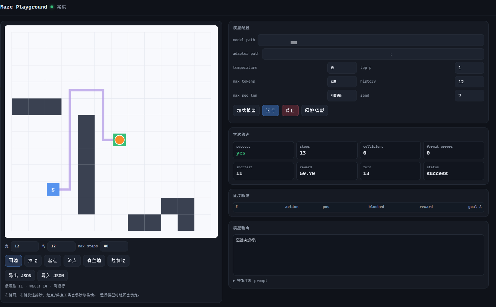

# Maze Playground UI

Playground 是一个独立的浏览器页面，用来：

- 自由设定迷宫宽高；
- 画墙、擦墙；
- 自由设置 start / goal；
- 导入、导出地图 JSON；
- 设置 adapter 和采样参数；
- 启动模型，实时查看每一步 tool call、位置和 reward。

页面地址：

```text
http://127.0.0.1:7861/playground
```



---

## 1. 启动

最小启动：

```bash
python -m env.ui
```

带默认 adapter：

```bash
python -m env.ui \
  --playground-adapter /tmp/opencode/grpo_unified_chunk17/grpo_agent.pt \
  --open
```

指定 GPU：

```bash
CUDA_VISIBLE_DEVICES=1 python -m env.ui \
  --playground-adapter /tmp/opencode/grpo_unified_chunk17/grpo_agent.pt
```

也可以指定默认 base model：

```bash
python -m env.ui \
  --playground-model /data/hjt1/Qwen3-0.6B \
  --playground-adapter /tmp/opencode/grpo_unified_chunk17/grpo_agent.pt
```

模型不会在启动页面时自动加载，第一次点击「运行」或「加载模型」时才加载。

---

## 2. 地图编辑

画布工具：

```text
画墙    左键/拖动添加墙
擦墙    左键删除墙，右键也可以快速擦除
起点    点击设置 start
终点    点击设置 goal
```

其他按钮：

```text
清空墙      删除所有墙
随机墙      生成约 18% 密度的随机墙
导出 JSON   导出当前地图
导入 JSON   从地图 JSON 恢复
```

地图约束：

```text
4 <= width, height <= 40
start != goal
start/goal 不能在墙上
goal 必须从 start 可达
max_steps >= 最短路径
```

满足条件后页面会显示：

```text
最短路 N · walls K · 可运行
```

不满足时会显示红色错误，运行按钮不可用。

---

## 3. 模型参数

页面可以设置：

```text
base model path
adapter path
temperature
top_p
max_tokens
history_window
max_seq_len
seed
```

操作：

```text
加载模型  只加载/替换模型和 adapter
运行      先校验地图，再启动一条完整轨迹
停止      请求在当前生成步之后停止
释放模型  释放模型和 GPU 显存
```

`adapter` 为空时使用 base model。  
运行过程中地图编辑会锁定，避免推理中途改变地图。

---

## 4. 轨迹展示

右侧显示：

- success / steps / collisions / format errors；
- shortest；
- total reward；
- 当前 turn 和运行状态；
- 逐步 action、position、blocked reason、reward、goal delta；
- 模型原始输出；
- 当前 prompt。

轨迹通过现有 SSE `/api/stream` 实时推送。

---

## 5. API

Playground 复用 `UIServer`，新增：

```text
GET  /playground                 页面
GET  /api/playground/config      默认模型、adapter、尺寸限制
GET  /api/playground/status      模型/运行状态
POST /api/playground/maze        校验并设置自定义地图
POST /api/playground/load        加载模型/adapter
POST /api/playground/run         启动一条轨迹
POST /api/playground/stop        请求停止
POST /api/playground/release     释放模型
```

自定义地图请求：

```json
{
  "width": 12,
  "height": 12,
  "walls": [[3, 2], [3, 3], [3, 4]],
  "start": [0, 0],
  "goal": [11, 11],
  "max_steps": 40
}
```

运行请求：

```json
{
  "model": "/data/hjt1/Qwen3-0.6B",
  "adapter": "/tmp/opencode/grpo_unified_chunk17/grpo_agent.pt",
  "temperature": 0.0,
  "top_p": 1.0,
  "max_tokens": 48,
  "history_window": 12,
  "max_seq_len": 4096,
  "seed": 7
}
```

---

## 6. 已知限制

- 单次只运行一条轨迹；还没有 G 条并行对比。
- 模型参数修改不会自动 reload；改 model/adapter 后需要点击加载或直接运行。
- 大尺寸地图会受 `max_steps` 和 `max_seq_len` 限制；
  12×12 之外属于零样本分布，效果会下降。
- 页面默认只监听 `127.0.0.1`，不要直接暴露到公网。
- 运行中途无法中断当前一次模型生成，只能在生成步结束后停止。

---

## 7. 相关代码

```text
env/playground.py       地图校验 + 模型 runner
env/playground_page.py  Playground HTML/CSS/JS
env/ui.py               HTTP 路由、SSE、UIServer
env/test_playground.py  校验和页面 API 测试
```
