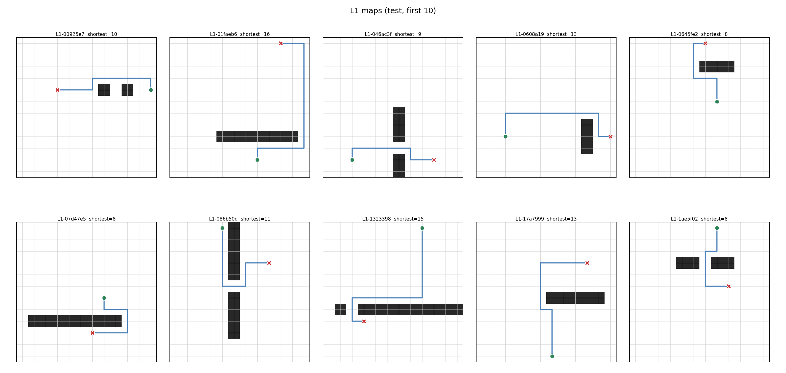
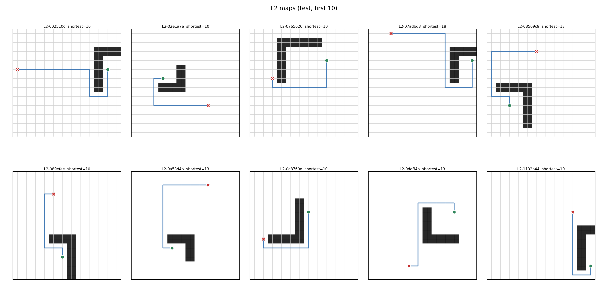
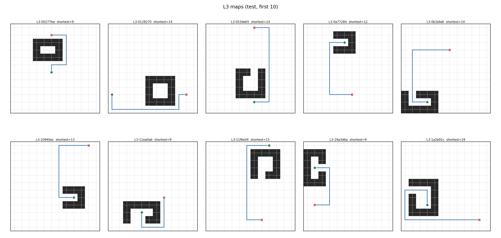
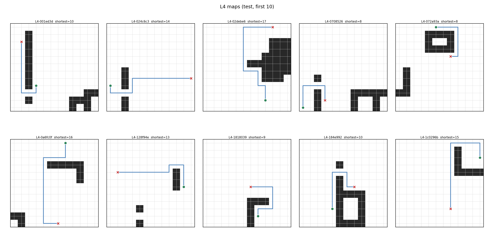
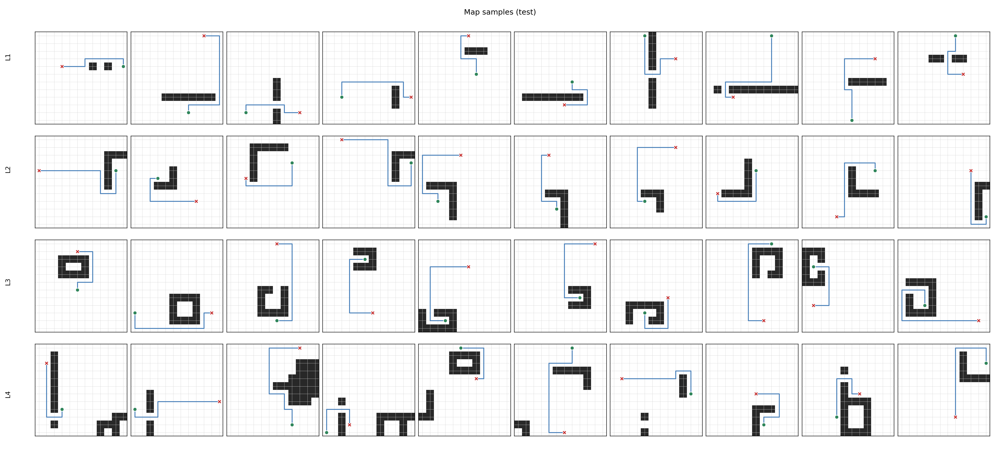

# Map 数据集报告

> 日期：2026-11-18 ｜ 版本：v3 ｜ 状态：**PASS**
> Builder：`scripts/build_maps_v3.py`
> Check：`scripts/check_maps_v3.py`
> 数据：`data/maps/{train,val,test}.jsonl` + `data/manifest.json`

---

## 1. 结论

当前训练/评估数据已经收敛成 **map-only**：

```text
Map = 尺寸 + 具体 walls + start + goal
```

墙形只在生成 map 和确定 level 时使用，不再作为独立数据层。相同墙形
放在不同位置就是不同 map。

当前规模：

| split | maps | L0 | L1 | L2 | L3 | L4 |
|---|---:|---:|---:|---:|---:|---:|
| train | 4000 | 800 | 800 | 800 | 800 | 800 |
| val | 500 | 100 | 100 | 100 | 100 | 100 |
| test | 500 | 100 | 100 | 100 | 100 | 100 |
| 合计 | 5000 | 1000 | 1000 | 1000 | 1000 | 1000 |

- 所有 split 的 map 唯一；
- split 之间没有重复 map；
- 所有 map 可解，`shortest <= max_steps - 2`；
- `shortest`、`detour` 与 BFS 重算结果一致；
- 每级满足对应的 `min_dist` / `min_detour`。

---

## 2. 数据单位

### 2.1 Map

```json
{
  "id": "L1-0123456789",
  "level": "L1",
  "width": 12,
  "height": 12,
  "max_steps": 30,
  "walls": [[2,3], [3,3], [2,4]],
  "start": [4,7],
  "goal": [2,2],
  "shortest": 9,
  "detour": 2,
  "hash": "..."
}
```

`id` 是 map 的唯一标识；`hash` 是
`(width,height,walls,start,goal)` 的内容哈希。

### 2.2 Map 唯一性判定

Map 是否相同，不由文件名、生成 seed 或 Python 对象决定，而由规范化后的
内容哈希决定：

```python
canonical_payload = {
    "w": int(width),
    "h": int(height),
    "walls": sorted([int(x), int(y)] for x, y in walls),
    "start": [int(start[0]), int(start[1])],
    "goal": [int(goal[0]), int(goal[1])],
}
hash = sha256(json.dumps(
    canonical_payload, sort_keys=True, separators=(",", ":")
).encode())
```

参与唯一性判断的字段只有：

```text
width
height
walls 的绝对坐标
start
goal
```

因此：

| 情况 | 是否相同 |
|---|---|
| walls 顺序不同，内容一样 | 相同 |
| seed 不同，但 walls/start/goal 一样 | 相同 |
| 同一墙形，摆在不同位置 | 不同 |
| 同一墙形和位置，start 不同 | 不同 |
| 同一墙形和位置，goal 不同 | 不同 |
| 尺寸不同 | 不同 |

当前 `level`、`max_steps`、`seed` 不参与内容哈希，只作为记录字段存在。
`map_id` 使用 `level + hash 前 10 位`，但唯一性校验使用完整 hash。

`check_maps_v3.py` 会检查：

- 全局 map content hash 唯一；
- map id 唯一；
- train/val/test 之间没有重复 map；
- 每条记录的 hash 与重新计算值一致。

> 如果以后要求 `level` 或 `max_steps` 也参与地图身份，需要把它们加入
> canonical payload，并重新生成数据集。

### 2.3 墙形

墙形不落盘成独立实体，只在生成时决定：

```text
L0：空地
L1：竖墙/横墙
L2：L 型墙
L3：U 型墙
L4：随机 1~3 个墙形
```

同一个墙形放在不同位置：

```text
墙形相同
绝对 walls 不同
→ 不同 map
```

### 2.4 轨迹与 step

轨迹和 step 不落盘：

```text
Map → BFS / rollout 轨迹 → step
```

SFT 当前每张 map 生成一条 BFS 最短路径；GRPO 才需要一张 map 的多条
rollout 轨迹。

---

## 3. Split

总量仍然是：

```text
4000 train maps
 500 val maps
 500 test maps
```

每个 level 均衡：

```text
train: 800 maps/level
val:   100 maps/level
test:  100 maps/level
```

split 规则分两级处理：

### L1–L4：按具体墙体集合分组

```text
wall_set_id = hash(width, height, sorted(absolute walls))
```

同一个 wall set 的所有 map 必须进入同一个 split。当前生成器每个
wall set 生成一张 map，因此 L1–L4 的 train/val/test 各自使用完全
不相交的 800/100/100 个墙体集合。

这样可以避免：

```text
同一组墙
+ 不同 start/goal
→ 一个在 train，一个在 val/test
```

### L0：按 map 划分

L0 只有一个空墙体集合，无法做 wall-set 隔离，因此按 map
（start/goal）哈希划分：

```text
L0 train: 800 maps
L0 val:   100 maps
L0 test:  100 maps
```

L0 的评估只能说明 start/goal 泛化，不能说明墙体泛化。

---

## 4. 文件

```text
data/
├── manifest.json
└── maps/
    ├── train.jsonl   4000
    ├── val.jsonl      500
    └── test.jsonl     500
```

manifest 记录：

- builder、seed、生成尺寸和 max_steps；
- split 规则和配额；
- 每个 split 的 map 数、level 分布；
- 每个文件的 sha256。

旧 v1 `maps`、v2 `layouts/tasks` 已归档到 `/tmp/opencode/old_data_backup/`，
不再作为当前数据入口。

---

## 5. 生成

```bash
python scripts/build_maps_v3.py \
  --out data \
  --seed 7 \
  --per-level 1000 \
  --train 800 --val 100 --test 100
```

生成过程：

1. 每个 level 生成候选 map；
2. L1–L4 每个具体 wall set 只取一张 map；L0 直接按 map hash 去重；
3. L1–L4 按 wall-set hash 排序；L0 按 map hash 排序；
4. 每级取 800/100/100 填入 train/val/test；
5. 写 manifest 和 sha256。

---

## 6. 校验

```bash
python scripts/check_maps_v3.py --data data
```

当前结果：

```text
train maps 4000 levels {'L0': 800, 'L1': 800, 'L2': 800, 'L3': 800, 'L4': 800}
train wall_sets {'L0': 1, 'L1': 800, 'L2': 800, 'L3': 800, 'L4': 800}
val   maps  500 levels {'L0': 100, 'L1': 100, 'L2': 100, 'L3': 100, 'L4': 100}
val   wall_sets {'L0': 1, 'L1': 100, 'L2': 100, 'L3': 100, 'L4': 100}
test  maps  500 levels {'L0': 100, 'L1': 100, 'L2': 100, 'L3': 100, 'L4': 100}
test  wall_sets {'L0': 1, 'L1': 100, 'L2': 100, 'L3': 100, 'L4': 100}
PASS map dataset checks
```

检查内容：

- manifest 的 sha256 和行数；
- map id / content hash 唯一；
- split 之间无重复 map；
- L1–L4 的 wall set 不跨 split；
- L0 只有一个空 wall set，按 map 划分；
- walls/start/goal 合法；
- BFS 可解；
- `shortest` / `detour` 一致；
- 满足 level 约束和 `max_steps`。

---

## 7. 训练时的恢复样本

恢复样本不写入 `data/maps`，由 `agent/sft_data.py` 在训练时生成：

```text
最优路径状态
→ 注入一个撞墙/撞边界动作
→ blocked=true 的 tool result
→ target 为正确的下一步动作
```

通过 `--recovery-per-task N` 控制，只用于 train split。

可复现性由：

```python
task_seed = (int(rec.hash[:16], 16) ^ (seed * 1000003)) & 0xFFFFFFFF
rng = random.Random(task_seed)
```

保证。固定 `seed`、map 数据和代码版本时，恢复样本相同。

map-only v3 的 L0/L1 训练结果见：

```text
reports/SFT_agent_v3_L0.md
reports/SFT_agent_v3_L1.md
reports/SFT_agent_v3_L2.md
reports/SFT_agent_v3_L3.md
reports/SFT_agent_v3_L4.md
reports/SFT_agent_v3_all.md
reports/AGENT_BASELINE.md
reports/GRPO_SCREEN_v3.md
reports/GRPO_SIGNAL_v3_L1.md
reports/GRPO_AGENT_v3_L1.md
reports/GRPO_UNIFIED_v3.md
```

---

## 8. 已知限制

- 当前仍是固定 12×12、max_steps=30；
- L1–L4 当前每个具体 wall set 只生成一张 map，因此没有同一组墙的
  多 start/goal 训练样本；
- L0 的墙为空，只有 start/goal 组合，不能验证墙体泛化；
- 轨迹/step 仍为运行时生成，不单独保存；
- 任意尺寸、任意墙形和任意 start/goal 仍是后续目标。

---

## 9. 测试集可视化

以下图片从 `data/maps/test.jsonl` 每个 level 按 hash 取前 10 张，
蓝线为一条 BFS 最短路径，绿点为 start，红叉为 goal。

L1：



L2：



L3：



L4：



总览：


