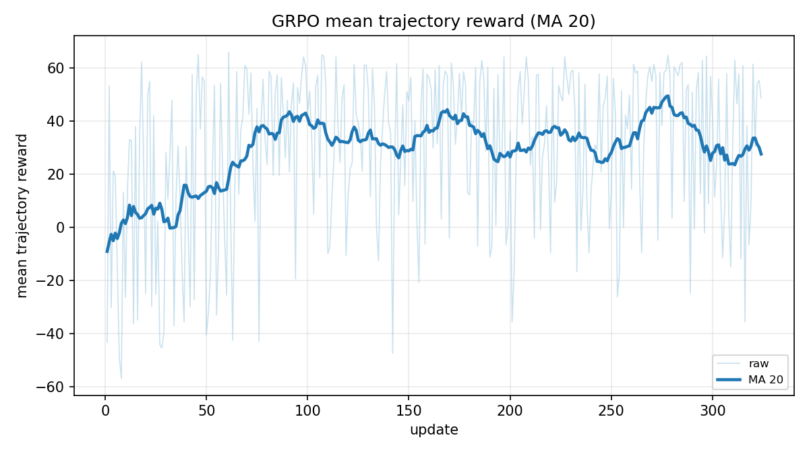
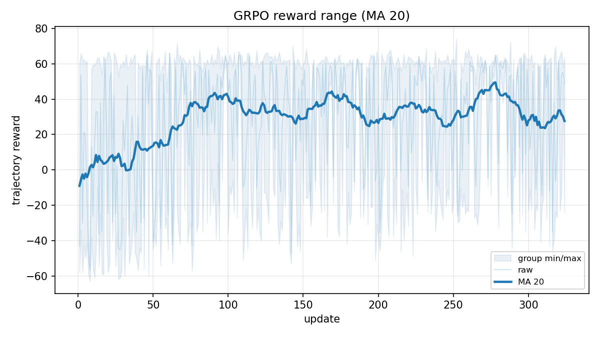
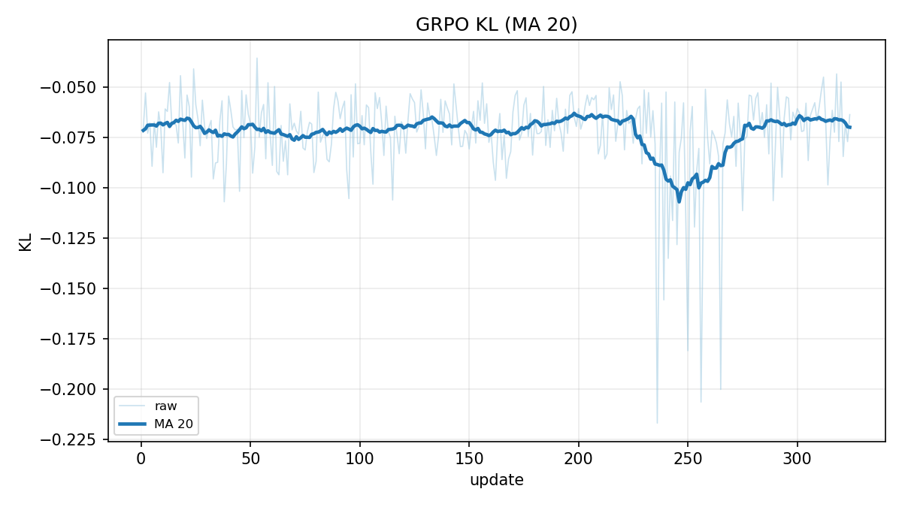
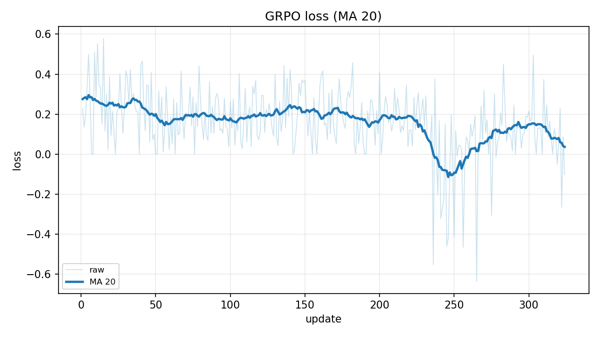
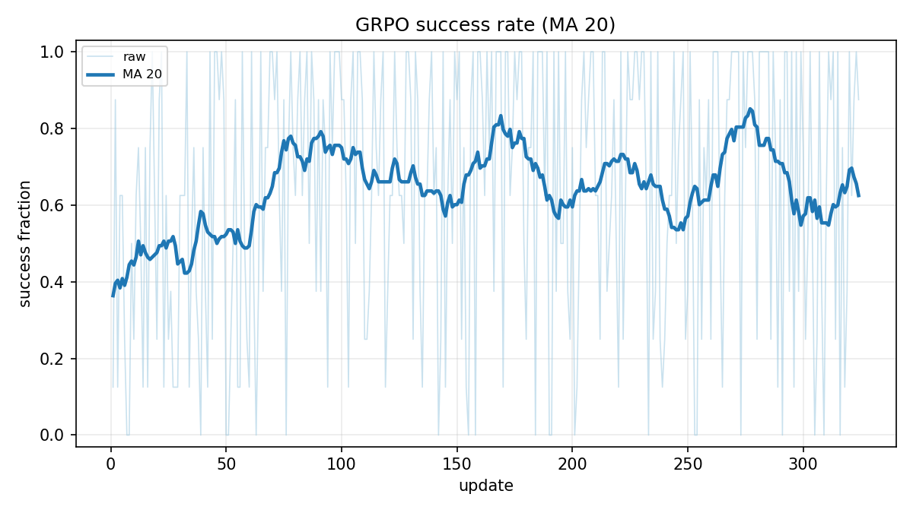

# 统一 GRPO 最终结果（全部 324 hard maps）

> 日期：2026-11-23 ｜ 模型：Qwen3-0.6B + LoRA
> 初始化：L4 SFT checkpoint
> 训练：324 / 324 hard maps，17 个 chunk
> 评估：greedy，temperature=0，每级 val/test 各 100

---

## 1. 结论

统一 GRPO 已完成全部 hard map 训练。最终模型在 L0–L4 上都保持了
成功，并且 L2–L4 有明显提升：

```text
最终 GRPO:  val 478/500 = 95.6%
            test 478/500 = 95.6%

L4:         80/79  ->  89/89
L3:         90/85  ->  97/95
L2:         91/92  ->  95/97
```

L0 val 有 1 个失败，L1 test 有 1 个失败，但整体明显好于 SFT 和
chunk1。L4 的提升最明显，说明 GRPO 对 hard map 的撞墙循环确实有作用。

最终 checkpoint：

```text
/tmp/opencode/grpo_unified_chunk17/grpo_agent.pt
```

---

## 2. 最终 L0–L4 评估

| level | val 成功 | test 成功 | mean steps val/test | collisions val/test | format errors val/test |
|---|---:|---:|---:|---:|---:|
| L0 | **99/100** | **100/100** | 13.4 / 13.6 | 18 / 15 | 0 / 0 |
| L1 | **98/100** | **97/100** | 12.8 / 13.0 | 59 / 40 | 0 / 0 |
| L2 | **95/100** | **97/100** | 15.1 / 15.0 | 80 / 56 | 1 / 0 |
| L3 | **97/100** | **95/100** | 15.2 / 15.4 | 98 / 105 | 1 / 1 |
| L4 | **89/100** | **89/100** | 17.1 / 17.0 | 112 / 127 | 0 / 0 |
| **总计** | **478/500** | **478/500** | 14.7 / 14.8 | **367 / 343** | **2 / 1** |

成功率：

```text
val:  478/500 = 95.6%
test: 478/500 = 95.6%
```

与 SFT、chunk1 的对比：

| level | SFT val/test | chunk1 val/test | final GRPO val/test |
|---|---:|---:|---:|
| L0 | 100/100 | 100/100 | 99/100 |
| L1 | 97/98 | 98/97 | 98/97 |
| L2 | 91/92 | 92/91 | **95/97** |
| L3 | 90/85 | 90/87 | **97/95** |
| L4 | 80/79 | 80/79 | **89/89** |
| **总计** | **458/454** | **460/454** | **478/478** |

相对 SFT：

```text
val:  +20 个任务（+4.0 个百分点）
test: +24 个任务（+4.8 个百分点）
```

碰撞次数：

```text
SFT:   val 1111 / test 1190
GRPO:  val  367 / test  343
```

碰撞总数分别减少约 67% 和 71%。L3/L4 的 30 步撞墙循环仍然存在，
但发生频率明显降低。

---

## 3. 训练概况

训练池：

```text
data/grpo/l1_l4_pool.json
total: 324
L1: 29
L2: 45
L3: 125
L4: 125
```

配置：

```text
G:            8
temperature:  0.8
top_p:        0.95
lr:           1e-5
beta:         0
history:      12
max_seq_len:  4096
```

训练更新：

```text
324 / 324
```

在 hard map 上的训练 rollout success：

```text
first 20 updates: 44.4%
last 20 updates:  60.0%
```

注意：每个 update 使用不同的 hard map，因此这个训练 success 只能作为
粗略诊断，不能直接当作固定评估集的提升幅度。最终结论以第 2 节的
固定 val/test 评估为准。

---

## 4. 曲线

完整 324 updates 的 reward、reward range、KL、loss 和 success 曲线。
浅色为原始逐 update 数据，深色为窗口 20 的 centered moving average：











原始 metrics：

```text
/tmp/opencode/grpo_unified_progress.json
```

每条记录包含 step reward、trajectory total reward、group advantage、
KL、loss、clip fraction 和梯度范数。

---

## 5. 评估说明

最终评估使用与 SFT/GRPO 相同的静态地图 agent 协议：

```text
system: 静态地图
user:   Begin the maze.
assistant: tool_call(move) + EOS
tool: compact JSON
```

评估设置：

```text
temperature:    0
eval batch:     8
history window: 12
max seq len:    4096
```

由于完整 5 级 × val/test 评估超过单次 30 分钟限制，最终结果按以下方式
汇总：

```text
val L0–L4: 一次完整评估
test L0:   同一次完整评估
test L1–L4: 分两个 test-only 进程完成
```

所有部分使用同一个最终 checkpoint、同一套 greedy 设置，因此结果是
可复现的。

剩余误差：

```text
format errors: val 2, test 1
```

SFT 主实验为 0 个 format error，因此 GRPO 后仍有极少量格式错误，
需要在后续评估中继续监控。

---

## 6. 相关文件

```text
reports/GRPO/SCREENING.md        hard map 筛选
reports/GRPO/UNIFIED_CHUNK1.md   chunk1 阶段结果
reports/GRPO/UNIFIED_FINAL.md    本文件
reports/curves/grpo/              最终 GRPO 曲线
scripts/train_grpo_agent.py      统一 GRPO 训练脚本
scripts/run_grpo_unified.sh      分块续跑脚本
```
