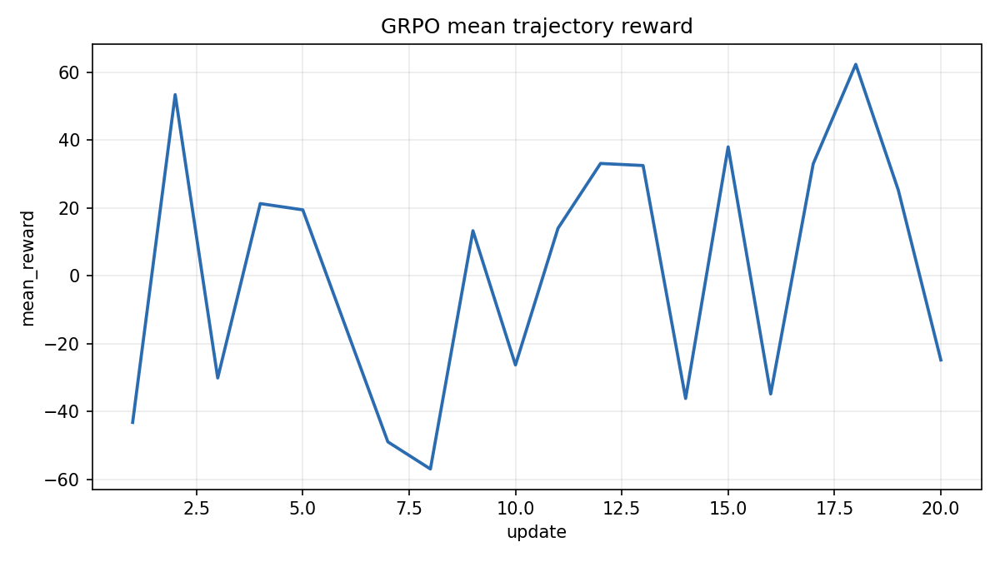
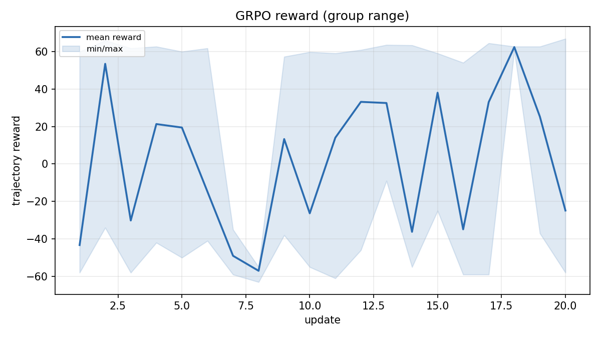
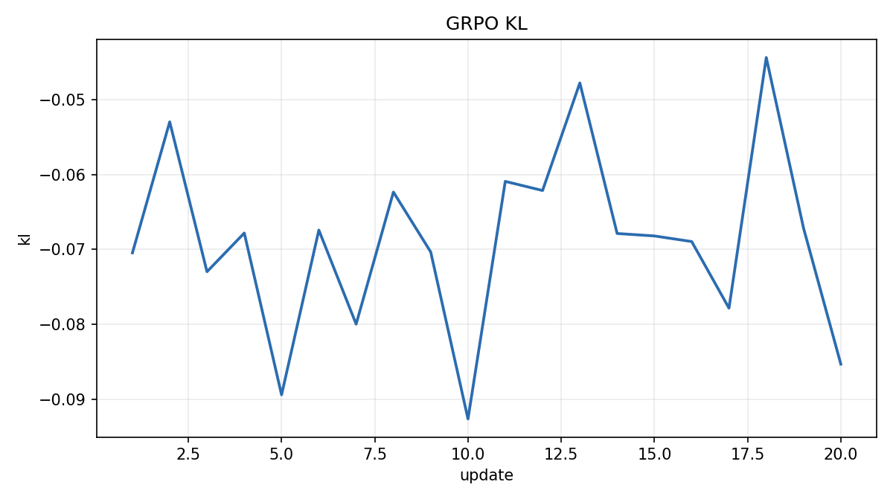
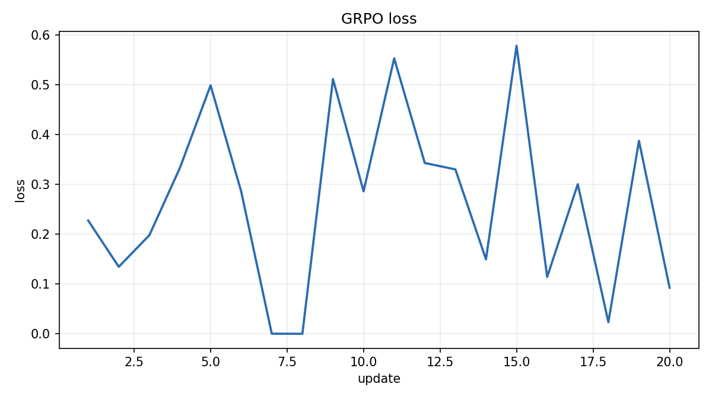
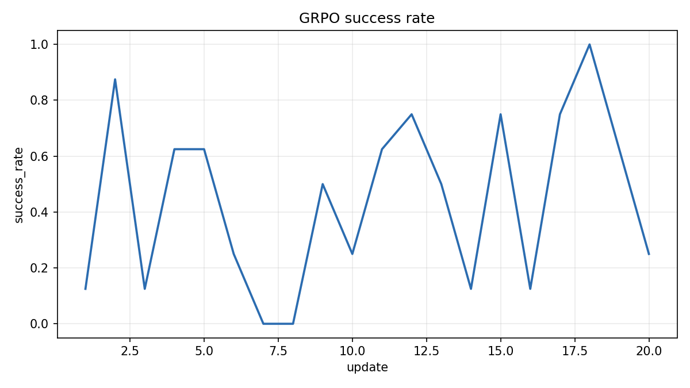
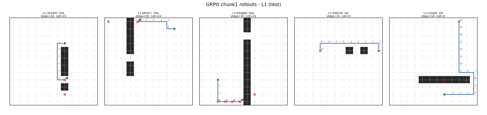
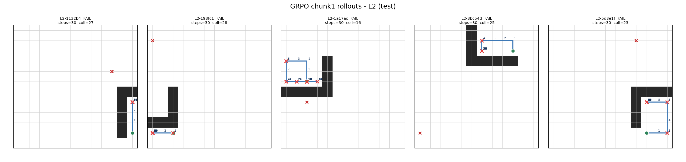
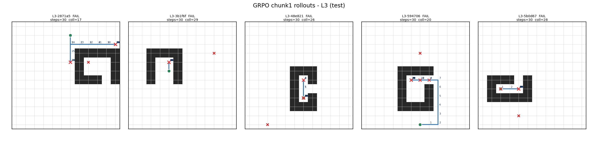
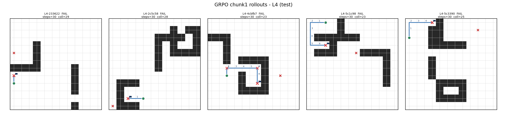

# GRPO 初步结果总结（v3，chunk1）

> 日期：2026-11-20 ｜ 模型：Qwen3-0.6B + LoRA
> SFT 起点：L4 SFT checkpoint
> GRPO checkpoint：`/tmp/opencode/grpo_unified_chunk1/grpo_agent.pt`

---

## 1. 结论

统一 GRPO chunk1 只训练了 **20 / 324** 个 hard map update，结果有一点点变化：

- L1：val +1，test -1
- L2：val +1，test -1
- L3：test +2
- L4：不变

整体还没有出现明显提升，困难墙体上的 30 步撞墙循环仍然存在。

---

## 2. 前置 greedy 筛选

用最终 L4 SFT checkpoint 对 L1–L4 全部 train maps 各跑一条 greedy 轨迹：

| level | n | easy | hard | fmt errors | mean collisions | mean steps |
|---|---:|---:|---:|---:|---:|---:|
| L1 | 800 | 771 | 29 | 0 | 0.88 | 12.46 |
| L2 | 800 | 755 | 45 | 0 | 1.43 | 14.24 |
| L3 | 800 | 675 | 125 | 0 | 4.22 | 16.17 |
| L4 | 800 | 675 | 125 | 2 | 3.95 | 16.39 |
| 合计 | 3200 | 2876 | **324** | 2 | — | — |

GRPO pool：

```text
data/grpo/l1_l4_pool.json
```

选择规则：

```text
greedy success == false
→ 进入 GRPO pool
```

不再做额外的 G=8 预探测；GRPO 内部在线采样 G=8，退化 group 跳过。

报告：

```text
reports/GRPO_SCREEN_v3.md
```

---

## 3. GRPO chunk1 设置

```text
initialization: L4 SFT checkpoint
pool:            324 hard maps
updates:         20
G:               8
temperature:     0.8
top_p:           0.95
lr:              1e-5
beta KL:         0
clip_eps:        0.2
history_window:  12
```

训练时每张 map 采样 8 条完整 Agent 轨迹；同一轨迹的所有 turn 使用同一个
轨迹级 advantage。

---

## 4. 评估结果

L4 SFT → GRPO chunk1：

| level | L4 SFT val/test | GRPO chunk1 val/test |
|---|---:|---:|
| L0 | 100/100, 100/100 | 100/100, 100/100 |
| L1 | 97/100, 98/100 | 98/100, 97/100 |
| L2 | 91/100, 92/100 | 92/100, 91/100 |
| L3 | 90/100, 85/100 | 90/100, 87/100 |
| L4 | 80/100, 79/100 | 80/100, 79/100 |

变化很小，L4 没有提升。

---

## 5. 训练曲线

Reward 是**轨迹级 total reward 的均值**，不是单步 reward：



Reward range：



KL：



Loss：



Success：



注意：

- GRPO 有 loss：policy-gradient loss + KL 项；
- 当前 `beta=0`，KL 只作为诊断指标；
- KL 采样估计可以为负，不代表训练一定异常。

---

## 6. 错误案例

可视化从 test set 每个 level 取 5 张 map；L1–L4 优先展示失败样本。

### L1



### L2



### L3



### L4



### 典型失败轨迹

| level | map | steps | collisions | actions |
|---|---|---:|---:|---|
| L1 | L1-361d91521e | 30 | 23 | down=28, left=1, right=1 |
| L1 | L1-af9327c158 | 30 | 24 | left=28, up=2 |
| L2 | L2-193fc1e11c | 30 | 28 | up=27, left=3 |
| L2 | L2-3bc54dd42c | 30 | 25 | left=16, down=13 |
| L3 | L3-3b1f6faacc | 30 | 29 | up=22, right=8 |
| L3 | L3-5b0d673443 | 30 | 28 | down=18, right=11 |
| L4 | L4-23362226b3 | 30 | 29 | up=29, left=1 |
| L4 | L4-2c5c58f39c | 30 | 28 | left=27, down=3 |

失败模式主要分两类：

```text
1. 单方向撞墙循环
   down/up/left/right 几乎一直重复

2. 两方向局部震荡
   down/up、left/right、left/down 交替
```

这些轨迹最终都耗尽 30 步，没有到达 goal。

GIF 动画：

```text
reports/curves/grpo_chunk1_rollout_L0.gif
reports/curves/grpo_chunk1_rollout_L1.gif
reports/curves/grpo_chunk1_rollout_L2.gif
reports/curves/grpo_chunk1_rollout_L3.gif
reports/curves/grpo_chunk1_rollout_L4.gif
```

---

## 7. 当前判断

```text
GRPO 有效果，但当前只训练了 20 个 update，
而且 hard pool 中仍有大量 all-fail / low-diversity 的 group。
```

当前主要瓶颈不是“没有 GRPO”，而是：

- 训练量太少：20 / 324；
- hard maps 的困难墙形仍然产生局部撞墙循环；
- 全失败 group 没有成功轨迹可以强化；
- reward 的 collision penalty 还不够改变探索行为；
- beta=0 没有参考策略约束。

---

## 8. 后续建议

1. 继续按 offset 训练剩余 hard maps；
2. 每个 chunk 保存 checkpoint、reward、KL、loss、success 曲线；
3. 对连续 chunk 观察 L1–L4 是否持续提升；
4. 如果 L4 仍不提升，考虑：
   - 增强重复碰撞/重复访问惩罚；
   - 增加 recovery depth；
   - DAgger 式错误状态纠正；
   - 用 `beta > 0` 的 KL 参考约束；
   - 对 all-fail group 做更细的失败分类，而不是直接进入 GRPO。

当前结论：

```text
GRPO 方向可行，但 20 个 update 只是初步验证，
还不能说统一 GRPO 已经解决困难墙体问题。
```
