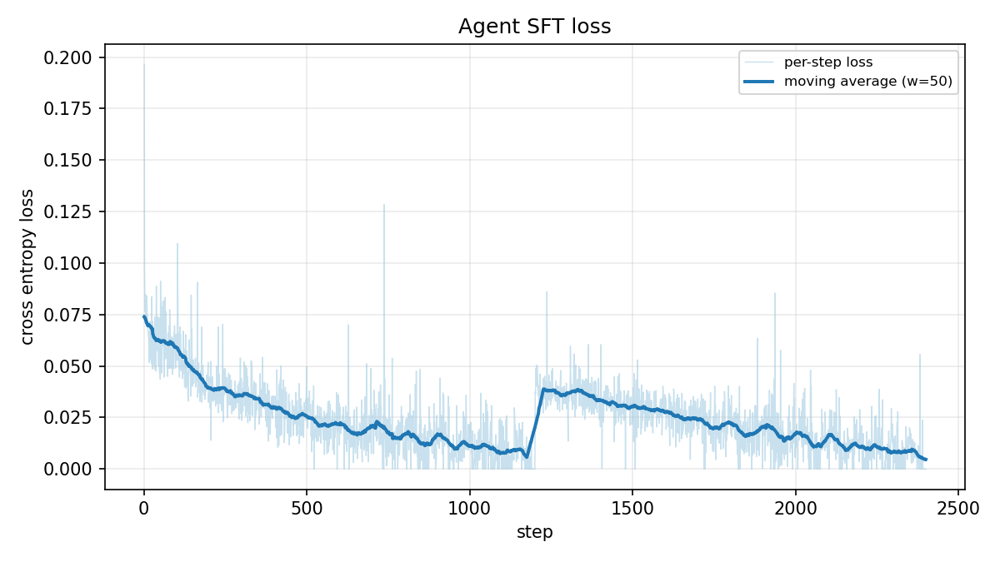

# Agent SFT L0：map-only v3

> 日期：2026-11-18 ｜ 模型：Qwen3-0.6B + LoRA
> 数据：`data/maps/{train,val,test}.jsonl` v3
> 训练脚本：`scripts/sft_agent.py`

---

## 1. 结论

在新的 map-only v3 数据上完成 L0 冷启动：

| 模型 | split | success | mean steps | collisions | format errors |
|---|---|---:|---:|---:|---:|
| base | val | 0/100 | 10.6 | 22 | 100 |
| base | test | 0/100 | 10.7 | 20 | 100 |
| SFT | val | **100/100** | 10.8 | 0 | 0 |
| SFT | test | **100/100** | 11.2 | 0 | 0 |

L0 是空地地图，只有 start/goal 组合不同；因此这次验证的是
**方向接地 + start/goal 泛化**，不是墙体泛化。

---

## 2. 数据

```text
L0 train maps: 800
L0 val maps:   100
L0 test maps:  100
```

所有 L0 map 共享同一个空墙集合，map 差异来自 start/goal。

SFT 数据：

```text
turns: 8816
```

动作分布：

```text
up=2313, down=2178, left=2150, right=2175
```

---

## 3. 训练配置

```text
base:           Qwen3-0.6B
adapter:        LoRA, r=16, alpha=32
lr:             5e-5
batch size:     8
epochs:         2
history window: 12
max seq len:    4096
recovery:       0
seed:           7
steps:          2400
```

Loss 曲线（浅色 per-step，粗线为 50-step moving average）：



### 3.1 为什么 epoch 切换时 loss 会上升

当前训练按 **精确 prompt 长度** 分桶：

```text
L0:
  prompt buckets: 178
  prompt range:   367..1424
  batch 内：同一 prompt 长度
  bucket 内：随机 shuffle
  bucket 顺序：短 → 长
```

训练共 2400 step，每个 epoch 1200 step：

```text
epoch 1: step 1..1200
epoch 2: step 1201..2400
```

到 step 1201 时，数据顺序从 epoch 1 的最后一批长 prompt，
重新回到 epoch 2 的最短 prompt bucket。

这不是模型在 step 1201 突然退化，而是：

```text
最后 10 step 的平均 loss ≈ 0.000003
epoch 2 开头 10 step 平均 loss ≈ 0.0423
```

但两个 epoch 的整体 loss 仍然在下降：

```text
epoch 1 mean loss: 0.0263
epoch 2 mean loss: 0.0218
```

所以 step 1201 附近的抬升是：

```text
数据分布 + bucket 顺序重置
```

不是训练发散。若希望曲线在 epoch 边界更连续，可以后续单独实验：

```text
每个 epoch 随机打乱 bucket 顺序
```

而不是只按 prompt 长度从短到长处理。

---

## 4. 评估

评估协议与训练一致：

```text
system: 静态地图
user:   Begin the maze.
assistant: move(direction)
tool: compact JSON
```

greedy 解码，`history_window=12`，每个 level 独立 batch=8。

SFT val/test 动作分布：

```text
val:  up=244, down=292, left=303, right=238
test: up=262, down=263, left=321, right=275
```

四个方向都正常使用，没有方向塌缩。

---

## 5. 基线对比

base model 在 L0 val/test 都是：

```text
success = 0
format_errors = 100
```

说明 base model 还没有稳定执行工具调用格式；SFT 后：

```text
format_errors = 0
collisions = 0
success = 100%
```

---

## 6. 复现

```bash
python scripts/sft_agent.py \
  --levels L0 \
  --maps 800 \
  --epochs 2 \
  --batch-size 8 \
  --lr 5e-5 \
  --history-window 12 \
  --max-seq-len 4096 \
  --recovery-per-task 0 \
  --val-limit 100 \
  --test-limit 100 \
  --eval-batch-size 8 \
  --seed 7 \
  --plot-dir /tmp/opencode/sft_agent_v3_l0/curves \
  --save-dir /tmp/opencode/sft_agent_v3_l0 \
  --json /tmp/opencode/sft_agent_v3_l0.json
```
