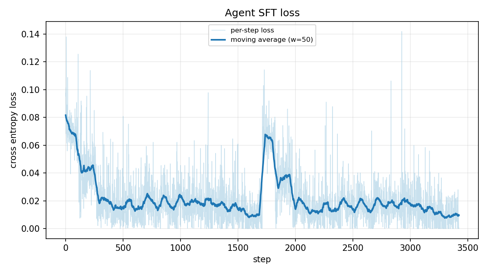

# Agent SFT L2：map-only v3

> 日期：2026-11-18 ｜ 模型：Qwen3-0.6B + LoRA
> 数据：`data/maps/{train,val,test}.jsonl` v3
> 训练脚本：`scripts/sft_agent.py`
> 初始化：L1 SFT e2 checkpoint

---

## 1. 结论

L2 SFT 完整评估：

| 模型 | split | success | mean steps | collisions | format errors |
|---|---|---:|---:|---:|---:|
| L2 SFT | val | **70/100** | 18.3 | 795 | 2 |
| L2 SFT | test | **83/100** | 16.4 | 528 | 0 |

L2 的 val/test 有差异，但整体已经学会 U/L 型墙的基本绕行。
L2 训练后，L0/L1 的保留情况反而很好：

| 级别 | split | success | mean steps | collisions | format errors |
|---|---|---:|---:|---:|---:|
| L0 | val | 100/100 | 11.3 | 0 | 0 |
| L0 | test | 100/100 | 11.8 | 1 | 0 |
| L1 | val | 96/100 | 12.9 | 122 | 0 |
| L1 | test | 94/100 | 13.4 | 150 | 0 |

也就是说，从 L1 checkpoint 训练 L2 后，L1 没有明显遗忘，反而在
这套测试上保持/提升到了 94–96%。

---

## 2. 数据

```text
L2 train maps: 800
L2 val maps:   100
L2 test maps:  100
```

L2 当前按具体墙体集合隔离：

```text
train: 800 个不同 wall sets
val:   100 个不同 wall sets
test:  100 个不同 wall sets
```

SFT 数据：

```text
turns: 11555
actions:
  up=2833, down=3015, left=2796, right=2911
```

---

## 3. 训练配置

```text
base:           Qwen3-0.6B
adapter:        LoRA, r=16, alpha=32
initialization: L1 SFT e2
lr:             5e-5
batch size:     8
epochs:         2
history window: 12
max seq len:    4096
recovery/task:  2
seed:           7
training time:  52.0 min
final epoch loss: 0.0203
```

Loss 曲线（浅色 per-step，粗线 50-step moving average）：



> 训练脚本在最后 test 收尾阶段退出过一次，checkpoint 已正常保存；
> 本文评估是使用该 checkpoint 单独补跑的完整 val/test 100。

---

## 4. 评估

协议与 SFT 相同：

```text
system: 静态地图
user:   Begin the maze.
assistant: move(direction)
tool: compact JSON
```

greedy 解码，`history_window=12`，batch=8。

动作分布：

```text
val:  up=590, down=374, left=485, right=382
test: up=423, down=441, left=510, right=268
```

val 出现了 2 次格式错误，test 为 0。

---

## 5. 关键观察

L2 训练后：

```text
L0 val/test: 100/100, 100/100
L1 val/test:  96/100,  94/100
```

这说明：

- L2 的 U/L 型墙训练没有破坏基础的 L0/L1 能力；
- L2 中的复杂墙体可能反向提升了 L1 的墙体泛化；
- 目前没有出现明显的 catastrophic forgetting。

但 L2 本身 val 70 / test 83，仍有较多撞墙和超时，后续仍需要 L3 和
统一 GRPO 来继续提升。

---

## 6. 复现

```bash
python scripts/sft_agent.py \
  --levels L2 \
  --maps 800 \
  --epochs 2 \
  --init-adapter /tmp/opencode/sft_agent_v3_l1_e2/sft_agent.pt \
  --recovery-per-task 2 \
  --batch-size 8 \
  --lr 5e-5 \
  --history-window 12 \
  --max-seq-len 4096 \
  --val-limit 100 \
  --test-limit 100 \
  --eval-batch-size 8 \
  --seed 7 \
  --plot-dir /tmp/opencode/sft_agent_v3_l2/curves \
  --save-dir /tmp/opencode/sft_agent_v3_l2 \
  --json /tmp/opencode/sft_agent_v3_l2.json
```
