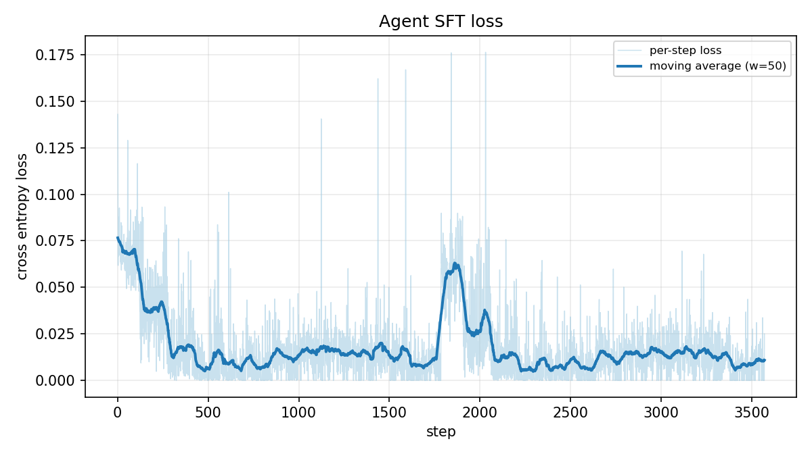

# Agent SFT L3：map-only v3

> 日期：2026-11-19 ｜ 模型：Qwen3-0.6B + LoRA
> 数据：`data/maps/{train,val,test}.jsonl` v3
> 训练脚本：`scripts/sft_agent.py`
> 初始化：L2 SFT checkpoint

---

## 1. 结论

L3 SFT 完整主评估：

| 模型 | split | success | mean steps | collisions | format errors |
|---|---|---:|---:|---:|---:|
| L3 SFT | val | **83/100** | 16.4 | 486 | 0 |
| L3 SFT | test | **78/100** | 17.4 | 570 | 0 |

L3 训练后，前面 level 的保留性：

| 级别 | val | test | mean steps (val/test) | collisions (val/test) |
|---|---:|---:|---:|---:|
| L0 | 100/100 | 100/100 | 11.4 / 12.0 | 1 / 1 |
| L1 | 97/100 | 98/100 | 12.7 / 13.1 | 72 / 87 |
| L2 | 77/100 | 88/100 | 17.6 / 15.4 | 656 / 349 |

L1 仍然保持 97/98，L2 也没有明显退化；L0 保持 100%。

---

## 2. 数据

```text
L3 train maps: 800
L3 val maps:   100
L3 test maps:  100
```

L3 墙体集合隔离：

```text
train: 800 个不同 wall sets
val:   100 个不同 wall sets
test:  100 个不同 wall sets
```

SFT 数据：

```text
turns: 11721
actions:
  up=2962, down=2939, left=3065, right=2755
```

---

## 3. 训练配置

```text
base:           Qwen3-0.6B
adapter:        LoRA, r=16, alpha=32
initialization: L2 SFT checkpoint
lr:             5e-5
batch size:     8
epochs:         2
history window: 12
max seq len:    4096
recovery/task:  2
seed:           7
training time:  55.2 min
final epoch loss: 0.0164
```

Loss 曲线（浅色 per-step，粗线 50-step moving average）：



---

## 4. 评估

协议与 SFT 相同：

```text
system: 静态地图
user:   Begin the maze.
assistant: move(direction)
tool: compact JSON
```

greedy 解码，`history_window=12`，batch=4/8。

动作分布：

```text
L3 val:  up=342, down=397, left=475, right=423
L3 test: up=340, down=440, left=433, right=522
```

format errors 为 0。

---

## 5. 关键观察

```text
L3 自身:  val 83 / test 78
L1 保留:  val 97 / test 98
L2 保留:  val 77 / test 88
```

L3 的 U 型墙训练没有破坏 L1/L2，L2 的测试成功率甚至比 L2
单独 SFT 更高。

---

## 6. 复现

```bash
python scripts/sft_agent.py \
  --levels L3 \
  --maps 800 \
  --epochs 2 \
  --init-adapter /tmp/opencode/sft_agent_v3_l2/sft_agent.pt \
  --recovery-per-task 2 \
  --batch-size 8 \
  --lr 5e-5 \
  --history-window 12 \
  --max-seq-len 4096 \
  --val-limit 100 \
  --test-limit 100 \
  --eval-batch-size 8 \
  --seed 7 \
  --plot-dir /tmp/opencode/sft_agent_v3_l3/curves \
  --save-dir /tmp/opencode/sft_agent_v3_l3 \
  --json /tmp/opencode/sft_agent_v3_l3.json
```

> 训练脚本在最后评估阶段退出过一次；主评估和保留性评估均使用保存的
> checkpoint 重新跑完。
