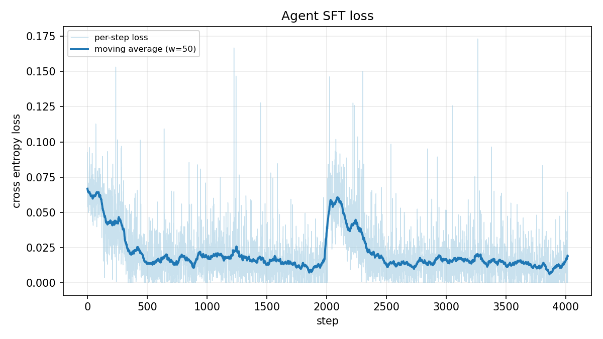

# Agent SFT L4：map-only v3

> 日期：2026-11-19 ｜ 模型：Qwen3-0.6B + LoRA
> 数据：`data/maps/{train,val,test}.jsonl` v3
> 训练脚本：`scripts/sft_agent.py`
> 初始化：L3 SFT checkpoint

---

## 1. 结论

L4 SFT 完整主评估：

| 模型 | split | success | mean steps | collisions | format errors |
|---|---|---:|---:|---:|---:|
| L4 SFT | val | **80/100** | 17.1 | 505 | 0 |
| L4 SFT | test | **79/100** | 17.5 | 471 | 0 |

L4 训练后，L0–L3 的保留性：

| 级别 | val | test |
|---|---:|---:|
| L0 | 100/100 | 100/100 |
| L1 | 97/100 | 98/100 |
| L2 | 91/100 | 92/100 |
| L3 | 90/100 | 85/100 |
| L4 | 80/100 | 79/100 |

L4 的随机墙训练没有破坏前面 level，L2/L3 甚至比单独 SFT 后更高。

---

## 2. 数据

```text
L4 train maps: 800
L4 val maps:   100
L4 test maps:  100
```

SFT 数据：

```text
turns: 11898
actions:
  up=3205, down=2839, left=2792, right=3062
```

墙体集合隔离：

```text
train: 800 个不同 wall sets
val:   100 个不同 wall sets
test:  100 个不同 wall sets
```

---

## 3. 训练配置

```text
base:           Qwen3-0.6B
adapter:        LoRA, r=16, alpha=32
initialization: L3 SFT checkpoint
lr:             5e-5
batch size:     8
epochs:         2
history window: 12
max seq len:    4096
recovery/task:  2
seed:           7
training time:  59.4 min
final epoch loss: 0.0199
```

Loss 曲线（浅色 per-step，粗线 50-step moving average）：



---

## 4. 评估

协议与 SFT 相同：

```text
system: 静态地图
user:   Begin the maze.
assistant: move(direction)
tool: compact JSON
```

greedy 解码，`history_window=12`，batch=4/8。

L4 动作分布：

```text
val:  up=381, down=436, left=460, right=434
test: up=416, down=458, left=461, right=414
```

format errors 为 0。

---

## 5. 关键观察

L4 的墙体是随机组合，难度最高：

```text
L4:   val 80 / test 79
L3:   val 90 / test 85
L2:   val 91 / test 92
L1:   val 97 / test 98
L0:   val 100 / test 100
```

说明逐级 SFT 课程没有出现明显遗忘，最终 L4 checkpoint 同时保持了
前四个 level 的能力。

GRPO 可以在这个最终 L4 SFT checkpoint 上统一进行。

---

## 6. 复现

```bash
python scripts/sft_agent.py \
  --levels L4 \
  --maps 800 \
  --epochs 2 \
  --init-adapter /tmp/opencode/sft_agent_v3_l3/sft_agent.pt \
  --recovery-per-task 2 \
  --batch-size 8 \
  --lr 5e-5 \
  --history-window 12 \
  --max-seq-len 4096 \
  --val-limit 100 \
  --test-limit 100 \
  --eval-batch-size 8 \
  --seed 7 \
  --plot-dir /tmp/opencode/sft_agent_v3_l4/curves \
  --save-dir /tmp/opencode/sft_agent_v3_l4 \
  --json /tmp/opencode/sft_agent_v3_l4.json
```

> L4 训练完成后训练脚本的评估阶段被后台进程超时终止；主评估和保留性
> 评估均使用保存的 checkpoint 在 GPU 1 上补跑完成。
