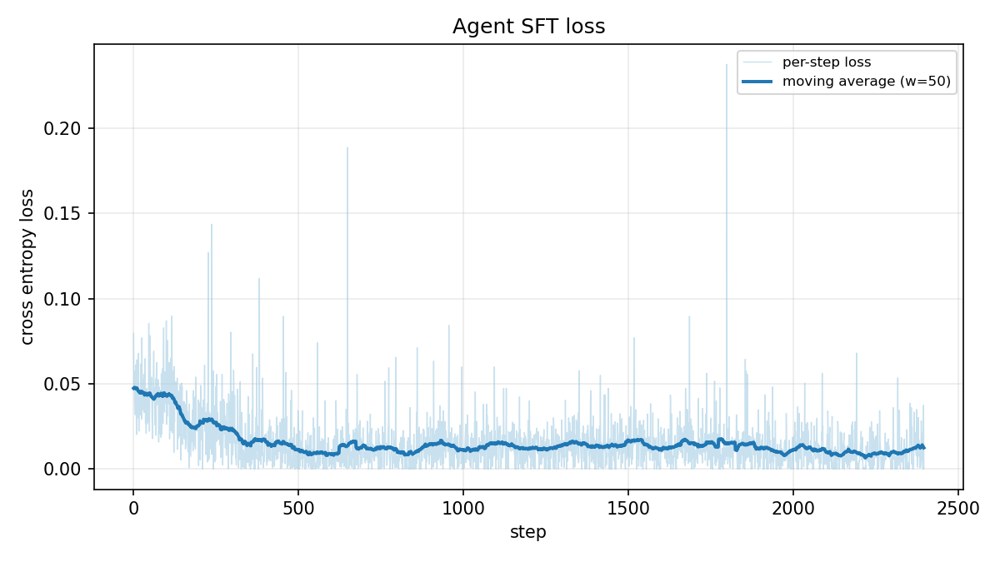

# L4 recovery_depth=3 实验

> 日期：2026-11-20 ｜ 初始化：L4 SFT checkpoint
> 数据：L4 800 train maps
> 目的：验证更长撞墙恢复轨迹是否能改善 L3/L4 的局部撞墙循环

---

## 1. 设置

```text
levels:            L4
epochs:            1
maps:              800
recovery_per_task: 2
recovery_depth:    3
lr:                3e-5
batch_size:        8
SFT turns:         14822
final loss:        0.0154
training time:     37.7 min
```

每条恢复样本在撞墙后继续训练最多 3 个正确动作，而不是只纠正下一步。

Loss 曲线：



---

## 2. 完整结果

| level | L4 SFT val/test | depth3 val/test |
|---|---:|---:|
| L0 | 100/100, 100/100 | 100/100, 100/100 |
| L1 | 97/98 | 96/96 |
| L2 | 91/92 | 87/93 |
| L3 | 90/85 | **89/89** |
| L4 | 80/79 | **79/81** |

L4 collisions：

```text
L4 SFT: 505 / 471
depth3:  401 / 395
```

L4 碰撞数下降，但出现了少量 format error：

```text
L4 SFT: 0 / 0
depth3: 4 / 0
```

---

## 3. 结论

收益：

- L4 test +2；
- L3 test +4；
- L4 collisions 明显下降；
- L3 collisions 也从 291/433 降到 282/239。

代价：

- L1 从 97/98 退到 96/96；
- L2 val 从 91 退到 87；
- L4 val -1；
- L4 出现 4 个 format error。

所以 `recovery_depth=3` 不是一个全面胜出的改动，但确实减少了 L4 的碰撞，
并让 L3 test 有提升。

---

## 4. 复现

```bash
python scripts/sft_agent.py \
  --levels L4 \
  --maps 800 \
  --epochs 1 \
  --recovery-per-task 2 \
  --recovery-depth 3 \
  --init-adapter /tmp/opencode/sft_agent_v3_l4/sft_agent.pt \
  --batch-size 8 \
  --lr 3e-5 \
  --history-window 12 \
  --max-seq-len 4096 \
  --val-limit 0 \
  --test-limit 0 \
  --eval-batch-size 4 \
  --seed 7 \
  --plot-dir /tmp/opencode/sft_agent_v3_l4_depth3/curves \
  --save-dir /tmp/opencode/sft_agent_v3_l4_depth3 \
  --json /tmp/opencode/sft_agent_v3_l4_depth3.json
```
