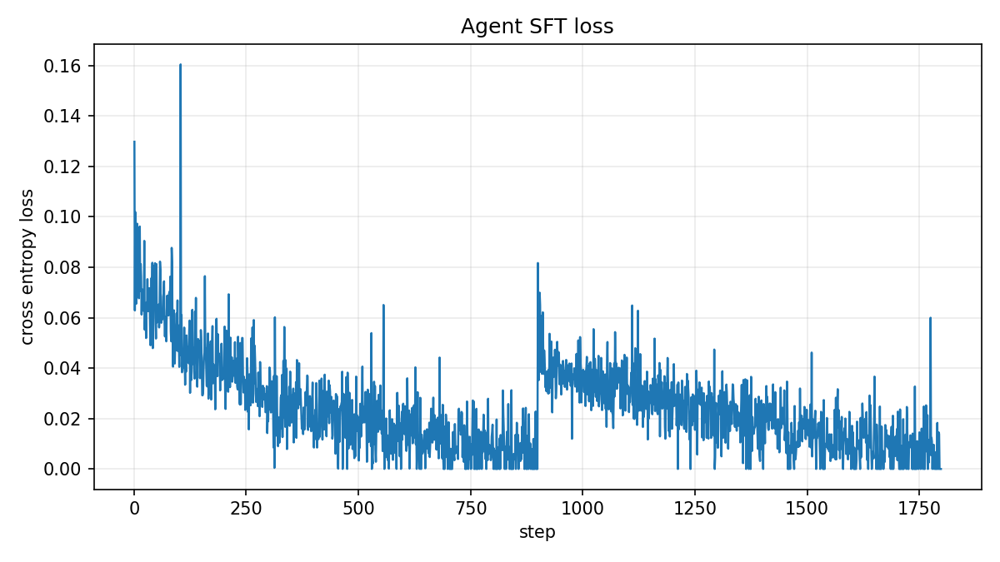

# Agent SFT L0：静态地图 + 紧凑 tool result

> 日期：2026-11-18 ｜ 模型：Qwen3-0.6B + LoRA
> 训练脚本：`scripts/sft_agent.py`
> 数据：`data/layouts` + `data/tasks`，L0 任务级 split

---

## 1. 结论

新 Agent 对话格式的 L0 SFT 已跑通：

```text
L0 train tasks: 600
SFT turns:      6533
epochs:         2
train steps:    1798
val:            80/80  (100%)
test:           80/80  (100%)
collisions:     0
format errors:  0
```

训练只监督 assistant 的 `tool_call + EOS`，system、user、tool result
均不参与 loss。

完整评估：

| split | n | success | mean steps | collisions | format errors |
|---|---:|---:|---:|---:|---:|
| val | 80 | 80 (100%) | 11.2 | 0 | 0 |
| test | 80 | 80 (100%) | 10.8 | 0 | 0 |

---

## 2. 数据与动作均衡

L0 只有一个空地 layout，split 按 task 哈希划分。

### 2.1 首动作 tie-break

固定 BFS 重建路径的顺序是 `up/down/left/right`，会把同距离的首步
偏向上下。SFT 数据生成改为在距离减 1 的邻居中随机选择：

```python
choices = [a for a in ACTIONS if distance(next(a)) == d - 1]
action = rng.choice(choices)
```

L0 train 600 个 task 的首动作：

```text
up=169, down=144, left=147, right=140
```

首动作已基本均衡；batch 内每个 turn 的动作总数也很接近：

```text
up=1676, down=1544, left=1733, right=1580
```

每个 task 只生成一条最短路径；同 task 的多路径变体留作后续实验。

---

## 3. 训练配置

```text
base:           Qwen3-0.6B
adapter:        LoRA, r=16, alpha=32
lr:             5e-5
batch size:     8
epochs:         2
history window: 12
max seq len:    4096
seed:           7
```

训练总 step 数：1798。

Loss 曲线（浅色为 per-step，粗线为 50-step centered moving average）：



平滑曲线从约 0.08–0.10 持续下降到接近 0；两个 epoch 的切换处有一个
短暂的 bucket 重排峰，但整体趋势稳定。

### 3.1 为什么 loss 曲线会有尖峰

L0 共 6533 个 SFT turns，按 **精确 prompt 长度** 分成了 153 个 bucket：

```text
prompt 长度范围：367..1415
每个 batch：同一 prompt 长度
bucket 顺序：短 → 长
bucket 内部：随机 shuffle
```

因此训练并不是把长短 prompt 混在同一个 batch 里，而是：

```text
epoch 1：短 prompt bucket → 长 prompt bucket
step 899：epoch 1 结束
step 900：epoch 2 从最短 bucket 重新开始
```

曲线上有两个不同现象：

| 位置 | 现象 | 原因 |
|---|---|---|
| step 104 | 单个 0.160 的尖峰 | 某个小 batch 的 loss 异常高；前后步约 0.04–0.06，下一步即恢复 |
| step 900 附近 | 平滑线整体抬升 | epoch 边界；epoch 1 末尾最后 10 步均值约 0.005，epoch 2 开头 10 步约 0.054 |

所以：

- step 104 的尖峰不是模型发散，而是一个 batch 的异常高 loss；
- step 900 附近是 epoch 分界，不是模型在这一步突然变差；
- 50-step moving average 把 epoch 边界前后的分布变化显示成了一个宽峰。

这种分桶方式的优点是：

- 不需要为短 prompt 补齐到长 prompt，减少 padding；
- 显存和计算更稳定；
- batch 构建和 `_pad_batch` 实现简单。

缺点是：

- 同一 batch 内的样本长度高度相关，梯度噪声更集中；
- 小 bucket 可能只有 1–2 个样本，单步 loss 很容易被一个难样本拉高；
- 每个 epoch 都按短到长重新开始，epoch 边界会产生人为的 loss 跳变；
- 意外形成“短 prompt → 长 prompt”的课程顺序，而不是全局随机混合。

这次没有修改训练逻辑；如果后续要改善曲线，优先考虑单独实验：

```text
保留长度分桶，但每个 epoch 打乱 bucket 顺序
```

或者使用长度区间分桶 / attention mask 做真正的变长 batch。

---

## 4. 评估协议

使用与训练完全相同的消息/tool 协议：

```text
system: 静态地图
user:   Begin the maze.
assistant: move(direction)
tool: compact JSON
```

评估采用 greedy 解码、`history_window=12`，独立 task 以 batch=8 并行。
每个 task 都从 `Start` 出发，直到 `done=true` 或达到步数上限。

---

## 5. 结果

完整 val/test 80 个 task 全部成功：

```text
val  actions: up=209, down=263, left=193, right=232
test actions: up=194, down=201, left=222, right=247
```

四个方向都有充分使用，没有出现之前小规模 SFT 中明显的右移偏置；
碰撞和格式错误均为 0。

L0 是空地任务，这一结果说明模型已经学会：

- 从起点读取坐标；
- 根据 goal_delta 选择方向；
- 连续多步移动；
- 使用 compact tool result 和历史消息；
- 到达目标后停止。

---

## 6. 复现

```bash
python scripts/sft_agent.py \
  --levels L0 \
  --maps 600 \
  --epochs 2 \
  --batch-size 8 \
  --lr 5e-5 \
  --history-window 12 \
  --max-seq-len 4096 \
  --val-limit 10 \
  --test-limit 10 \
  --seed 7 \
  --plot-dir /tmp/opencode/sft_agent_l0_600/curves \
  --save-dir /tmp/opencode/sft_agent_l0_600 \
  --json /tmp/opencode/sft_agent_l0_600.json
```

完整评估：

```bash
python scripts/sft_agent.py \
  --eval-only \
  --init-adapter /tmp/opencode/sft_agent_l0_600/sft_agent.pt \
  --levels L0 \
  --history-window 12 \
  --max-seq-len 4096 \
  --val-limit 80 \
  --test-limit 80 \
  --eval-batch-size 8 \
  --json /tmp/opencode/sft_agent_l0_600_full.json
```

---

## 7. 已知限制

- L0 是空地，只能验证方向接地和多步移动，**不能验证绕墙**；
- 每个 task 只有一条 BFS 路径；
- 训练数据与评估任务均来自同一 L0 layout，只按 task 泛化；
- 旧 stateless SFT/GRPO 结果不能直接和新 Agent 格式比较；
- L1–L4 的 layout 级泛化尚未验证。
