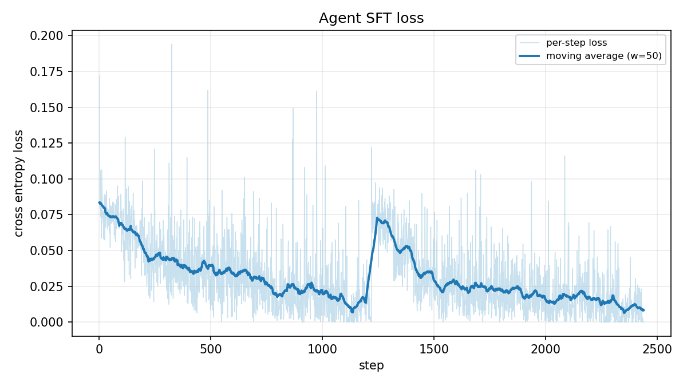
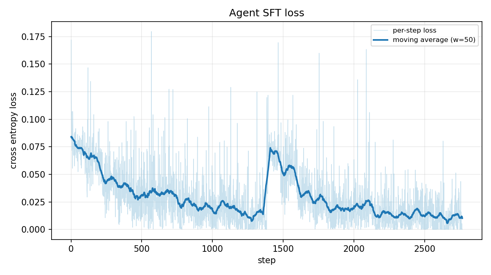
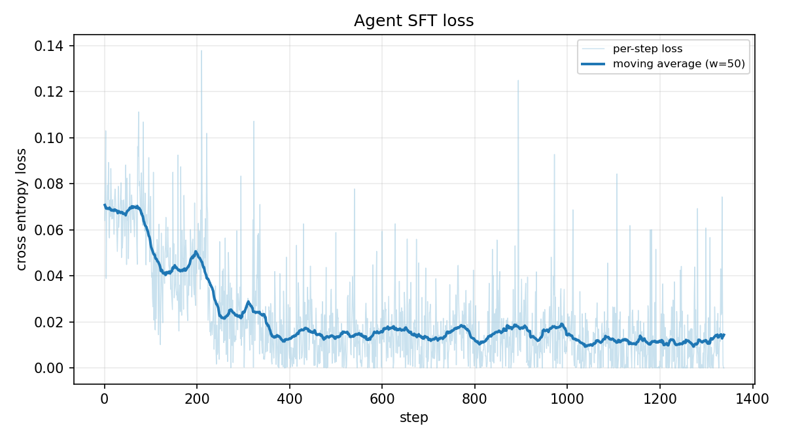
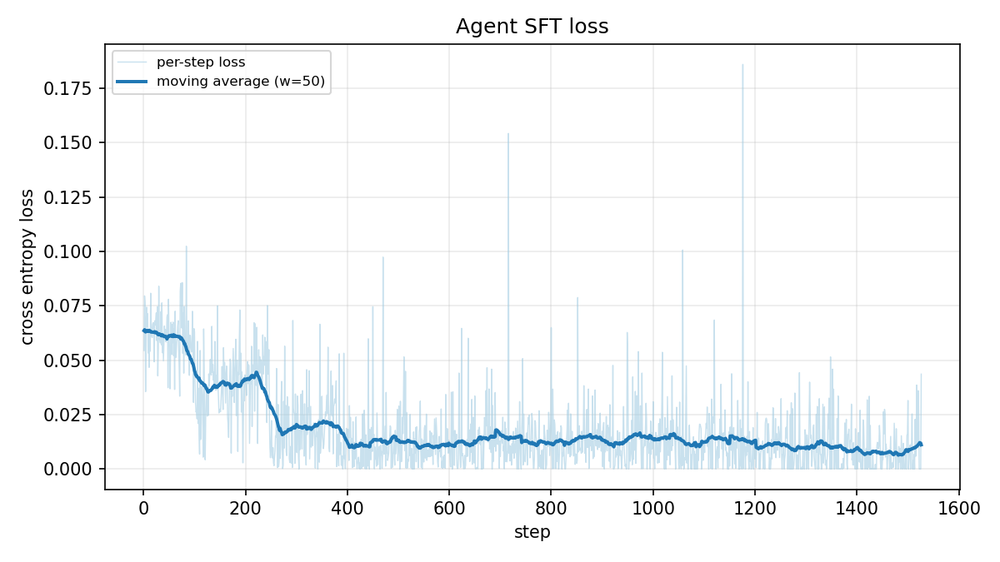

# Agent SFT L1：带墙布局、撞墙恢复与 layout 覆盖

> 日期：2026-11-18 ｜ 模型：Qwen3-0.6B + LoRA
> 训练脚本：`scripts/sft_agent.py`
> 数据：`data/layouts` + `data/tasks`；layout 级 split

---

## 1. 结论

L1 比 L0 明显更难。第一轮只用最优路径 SFT 时，模型不会处理撞墙：

```text
L1 600 tasks, 2 epochs
val:  2/10
test: 5/10
```

加入撞墙恢复样本后：

```text
recovery=2 / 当前 tasks
val:  63/80  (78.75%)
test: 59/80  (73.75%)
```

再改用布局覆盖更大的 source maps：

```text
source maps 600 张，532 个 layout
recovery=2，1 epoch
val:  72/80  (90.0%)
test: 66/80  (82.5%)
```

把 recovery 提高到 8 后：

```text
val:  73/80  (91.25%)
test: 66/80  (82.5%)
```

提升已经很小（val +1，test 不变），但碰撞从 241/398 降到
199/345。L1 还没有完全饱和；主要收益来自 layout 覆盖和恢复样本。

---

## 2. 第一轮失败：只会正样本

失败轨迹调试：

```text
正确路径前 4 步
→ 撞到边界
→ 连续 5 次以上输出同一个已撞墙方向
→ 最终超时
```

原 SFT 轨迹全部来自 BFS 最短路径，训练中只有：

```text
ok=true / blocked=false
```

模型从未见过 `blocked=true` 的 tool result，因此不会根据
`blocked`、`blocked_by`、`reason` 改方向。

---

## 3. 撞墙恢复样本

新增 `--recovery-per-task N`：

- 沿最优路径走；
- 在最多 N 个 path state 注入一个真实会被墙/边界挡住的动作；
- 生成对应的 tool result；
- prompt 中保留这次失败历史；
- target 是同一 state 下真正正确的下一步动作。

训练 prompt 中会出现：

```text
assistant: move(up)
tool: {"moved":"up","ok":false,"pos":[...],"blocked":true,
       "blocked_by":"wall","reason":"You hit a wall..."}

assistant: move(right)   ← 训练目标
```

恢复样本和最优路径样本同时保留。

---

## 4. Layout 覆盖

对比两种训练数据：

| 训练数据 | tasks | layout 数 | SFT turns |
|---|---:|---:|---:|
| `data/tasks/train` | 600 | 120 | 7103（无 recovery） |
| 同上 + recovery=2 | 600 | 120 | 8247 |
| `data/maps/train` + recovery=2 | 600 | 532 | 7819 |

`data/maps/train` 的 L1 源地图提供了远多于新 task 集的 layout 覆盖。
source map 模型从 recovery checkpoint 继续训练 1 epoch。

---

## 5. 训练配置

```text
base:              Qwen3-0.6B
adapter:           LoRA, r=16, alpha=32
lr:                5e-5
batch size:        8
epochs:            2（当前 tasks）/ 1（source maps 继续训练）
history window:    12
max seq len:       4096
recovery/task:     2；recovery=8 实验为 8
seed:              7
```

Loss 曲线（浅色为 per-step，粗线为 50-step centered moving average）：

无 recovery：



recovery=2：



source maps + recovery=2：



source maps + recovery=8：



---

## 6. 结果

| 模型 | val | test | 说明 |
|---|---:|---:|---|
| 无 recovery | 2/10 | 5/10 | 10 个任务的调试评估 |
| 当前 tasks + recovery=2 | **63/80 (78.75%)** | **59/80 (73.75%)** | 完整 80 任务 |
| source maps + recovery=2 | **72/80 (90.0%)** | **66/80 (82.5%)** | 完整 80 任务 |
| source maps + recovery=8 | **73/80 (91.25%)** | **66/80 (82.5%)** | 完整 80 任务 |

source maps + recovery=2 的动作分布：

```text
val  actions: up=425, down=262, left=230, right=271
test actions: up=426, down=349, left=255, right=252
```

四个方向都正常使用，没有 L0 早期那种单一方向塌缩；format errors 为 0。
recovery=2 仍有较多碰撞（val 241、test 398）；recovery=8 降到
val 199、test 345，但 test 成功率没有继续提高。失败样本通常以
撞墙循环或 30 步超时结束。

---

## 7. 分析

- recovery 解决了“见过 blocked result 后仍重复同一动作”的一部分问题；
- 继续增加 recovery（2 → 8）只带来很小的收益，说明当前瓶颈更多是
  **未见 layout 的路径规划**，而不只是碰撞处理；
- source maps 的训练集从 120 个 layout 扩展到 532 个 layout，收益最大；
- L1 test 仍有 14/80 失败，失败轨迹常见撞墙循环或 30 步超时；
- 下一步进入 L2 前，优先考虑增加训练 layout/task 覆盖，而不是单纯
  增加 epoch 或 recovery 次数。

## 8. 下一步

- 保留 source maps + recovery=8 作为 L1 当前最佳 checkpoint；
- 进入 L2，重点验证 U 型墙和更长 detour；
- 需要保留“静态地图”协议，不把完整 observation 每轮塞回 tool result。

---

## 9. 复现

当前 tasks + recovery：

```bash
python scripts/sft_agent.py \
  --levels L1 --maps 600 --epochs 2 \
  --recovery-per-task 2 \
  --batch-size 8 --lr 5e-5 \
  --history-window 12 --max-seq-len 4096 \
  --seed 7 \
  --plot-dir /tmp/opencode/sft_agent_l1_600_recovery/curves \
  --save-dir /tmp/opencode/sft_agent_l1_600_recovery \
  --json /tmp/opencode/sft_agent_l1_600_recovery.json
```

source maps 继续训练：

```bash
python scripts/sft_agent.py \
  --levels L1 --maps 600 --train-source maps \
  --epochs 1 --recovery-per-task 2 \
  --init-adapter /tmp/opencode/sft_agent_l1_600_recovery/sft_agent.pt \
  --batch-size 8 --lr 5e-5 \
  --history-window 12 --max-seq-len 4096 \
  --seed 7 \
  --plot-dir /tmp/opencode/sft_agent_l1_600_maps/curves \
  --save-dir /tmp/opencode/sft_agent_l1_600_maps \
  --json /tmp/opencode/sft_agent_l1_600_maps.json
```

recovery=8：

```bash
python scripts/sft_agent.py \
  --levels L1 --maps 600 --train-source maps \
  --epochs 1 --recovery-per-task 8 \
  --init-adapter /tmp/opencode/sft_agent_l1_600_maps/sft_agent.pt \
  --batch-size 8 --lr 5e-5 \
  --history-window 12 --max-seq-len 4096 \
  --seed 7 \
  --plot-dir /tmp/opencode/sft_agent_l1_600_maps_r8/curves \
  --save-dir /tmp/opencode/sft_agent_l1_600_maps_r8 \
  --json /tmp/opencode/sft_agent_l1_600_maps_r8.json
```

完整评估：

```bash
python scripts/sft_agent.py \
  --eval-only \
  --init-adapter /tmp/opencode/sft_agent_l1_600_maps_r8/sft_agent.pt \
  --levels L1 --val-limit 80 --test-limit 80 \
  --eval-batch-size 8 \
  --json /tmp/opencode/sft_agent_l1_600_maps_r8_full.json
```
